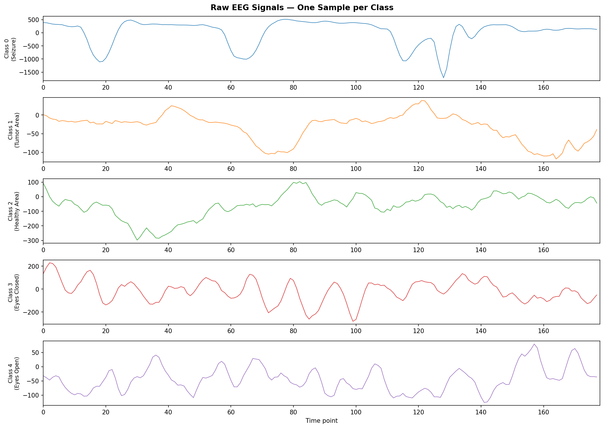
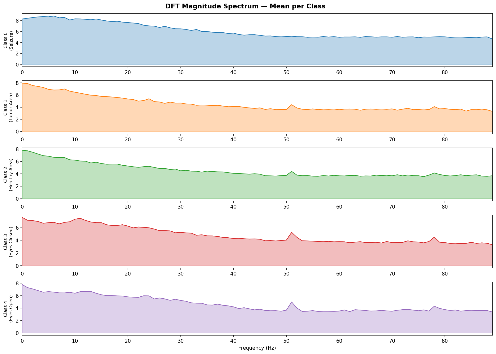
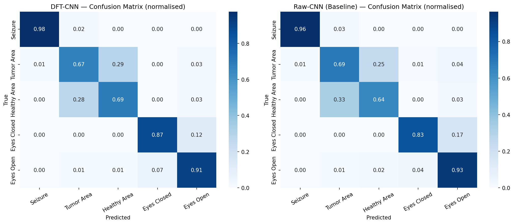
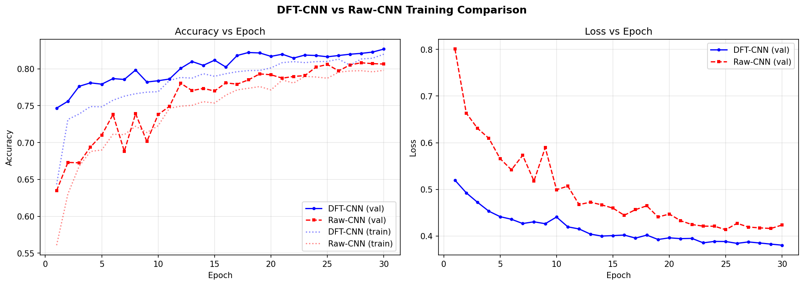

# DFT-CNN: Frequency-Domain Feature Learning for EEG Classification

[](https://www.python.org/)
[](https://pytorch.org/)
[](DFT_CNN_EEG.ipynb)
[](LICENSE)

Using the **Discrete Fourier Transform (DFT)** as a preprocessing stage for **1D CNN** classification of
EEG signals. This project asks a simple Digital Signal Processing question:

> *Does transforming EEG from the time domain to the frequency domain before training a CNN
> improve classification — or is end-to-end learning from the raw waveform better?*

**Answer:** yes, modestly but consistently. On the UCI Epileptic Seizure Recognition dataset, the
DFT-CNN reaches **82.33%** test accuracy vs. **81.05%** for the raw-signal CNN, using **49% fewer input
features** (90 bins vs. 178 samples) and training **1.46× faster** (31% less wall-clock time).

---

## Highlights

| Contribution | Result |
|---|---|
| DFT log-magnitude preprocessing vs. raw time-domain input | **82.33%** vs. 81.05% test accuracy (+1.27 pp) |
| Input dimensionality | 178 samples → **90 frequency bins** (−49%) |
| Training time (30 epochs) | **57.06 s** vs. 83.11 s (**−31%**, 1.46× faster) |
| Ablation: magnitude vs. phase | Magnitude **82.67%**, phase-only **48.46%** (≈ chance for 5-way) |
| Best class | Seizure: **F1 = 0.979** |
| Hardest classes | Tumor area (0.679) & healthy area (0.688) — spectrally similar |
| Model size | **295,237** trainable parameters (identical across all variants) |

---

## Dataset

**UCI Epileptic Seizure Recognition** — 11,500 one-second EEG windows, sampled at 178 Hz
(178 amplitude values per sample), balanced across 5 classes (2,300 each):

| Label | Class |
|:---:|---|
| 0 | Seizure activity |
| 1 | EEG from tumor area |
| 2 | EEG from healthy brain area |
| 3 | Eyes closed (healthy subject) |
| 4 | Eyes open (healthy subject) |

Source: [UCI Machine Learning Repository](https://archive.ics.uci.edu/dataset/388/epileptic+seizure+recognition),
derived from Andrzejak et al. (2001).

The CSV (`DataSet/Epileptic Seizure Recognition.csv`, 7.3 MB) is included in this repository. If it is
missing, download it from UCI and place it in **`DataSet/`** — that is where the notebook looks for it
(it falls back to the repository root as well).

---

## Quickstart

```bash
# 1. Clone
git clone https://github.com/NESHADUR/dft-cnn-eeg-classification.git
cd dft-cnn-eeg-classification

# 2. Environment (Python 3.9+)
python -m venv .venv
# Windows:  .venv\Scripts\activate
# macOS/Linux:
source .venv/bin/activate

# 3. Dependencies
pip install -r requirements.txt

# 4. Run
jupyter notebook DFT_CNN_EEG.ipynb
```

Run the notebook top to bottom. On a modern CPU the full pipeline (4 model trainings + all analyses)
takes **a few minutes** — no GPU required, though CUDA/MPS is used automatically if available.

A fixed seed (`SEED = 42`) and a fixed 70/15/15 index split are used for *every* experiment, so the
DFT-CNN and Raw-CNN see byte-identical train/validation/test partitions. Accuracy may vary by a few
tenths of a percent between runs on different hardware.

All paths are relative to the repository root: the notebook reads the CSV from `DataSet/`, and writes
regenerated figures and checkpoints to `Figure/` and `Models/` (both created automatically if absent).

### Using the pre-trained weights

`Models/model_dft_cnn.pth` and `Models/model_raw_cnn.pth` are the best-validation checkpoints. They must be loaded
into an `EEG_CNN` instance of the matching input length (90 for DFT, 178 for raw):

```python
import torch
from pathlib import Path

# EEG_CNN is defined in the notebook (cells "class EEG_CNN")
model = EEG_CNN(input_length=90)                       # 178 for the raw model
model.load_state_dict(torch.load('Models/model_dft_cnn.pth', map_location='cpu'))
model.eval()

X_dft = apply_dft(X_raw)                               # log(1 + |rfft(x)|), shape (N, 90)
X_dft = (X_dft - X_dft.mean()) / X_dft.std()           # same normalisation as training
logits = model(torch.tensor(X_dft[:1]).unsqueeze(1))
```

---

## Pipeline

```
raw EEG (178 samples)
        │
        ├──► Raw-CNN ................... baseline, time domain
        │
        └──► rfft ──► 90 bins ──► log(1 + |X|) ──► z-score ──► DFT-CNN
                                       │
                                       ├──► phase-only CNN ....... ablation
                                       └──► magnitude + phase ..... ablation
```

**Preprocessing.** `rfft` over the 178-sample window yields 90 positive-frequency bins (0–89 Hz,
1 Hz resolution). The log-magnitude spectrum `log(1 + |X|)` compresses the dynamic range and
stabilises training; each representation is then standardised using training-set statistics.

**Architecture** (shared by all variants, so *only the input representation changes*):

```
Conv1d(1→32, k=5) + BN + ReLU + MaxPool(2) + Dropout(0.2)
Conv1d(32→64, k=3) + BN + ReLU + MaxPool(2) + Dropout(0.2)
Conv1d(64→128, k=3) + BN + ReLU + AdaptiveAvgPool(8) + Dropout(0.3)
Flatten → Linear(1024→256) + ReLU + Dropout(0.4) → Linear(256→5)
```

`AdaptiveAvgPool1d(8)` decouples the classifier from input length, which is what makes a
*controlled* comparison possible: 295,237 parameters regardless of whether the input is 90, 178 or 180 long.

**Training.** Adam (lr 1e-3, weight decay 1e-4), StepLR (step 10, γ 0.5), batch size 64,
Cross-Entropy loss, 30 epochs, best-validation checkpoint restored before testing.

---

## Results

### Model comparison (test set)

| Model | Input | Length | Accuracy | Macro F1 |
|---|---|:---:|---:|---:|
| Raw-CNN | Time | 178 | 0.8105 | 0.8123 |
| **DFT-CNN (log-magnitude)** | **Frequency** | **90** | **0.8233** | **0.8247** |
| Mag+Phase-CNN | Both | 180 | 0.7903 | 0.7875 |
| Phase-CNN | Phase | 90 | 0.4890 | 0.4862 |

Phase-only performance collapsing to ~49% is the most striking ablation result: for this task the
*power distribution* carries essentially all of the class information, while the phase spectrum —
which is highly sensitive to where the 1-second window happens to start — behaves like noise.
Concatenating phase onto magnitude (180 features) actually *hurts* (79.03%), which is why the
final model uses magnitude alone.

### Per-class performance (DFT-CNN vs. Raw-CNN)

| Class | DFT-CNN F1 | Raw-CNN F1 | Note |
|---|:---:|:---:|---|
| Seizure | 0.979 | 0.975 | Distinctive spectral signature; near-perfect recall |
| Tumor Area | 0.679 | 0.679 | Hardest class; often confused with healthy area |
| Healthy Area | 0.688 | 0.663 | DFT helps recall (+5 pp) |
| Eyes Closed | 0.897 | 0.883 | Alpha-band (8–13 Hz) phenomenon |
| Eyes Open | 0.880 | 0.863 | Alpha attenuation |

The gains concentrate exactly where theory predicts: classes defined by *frequency-domain* phenomena
(alpha presence/absence) benefit most, and that is the strongest evidence that the DFT is doing
something meaningful rather than acting as a generic regulariser.

### Figures

| | |
|---|---|
|  |  |
| **Fig 1** — Raw time-domain EEG, one sample per class | **Fig 2** — DFT magnitude spectra reveal the class structure the CNN exploits |
|  |  |
| **Fig 4** — Confusion matrices (DFT vs. raw) | **Fig 3** — Training and validation convergence |

More: Fig 5 ablation &nbsp;·&nbsp; Fig 7 frequency interpretation &nbsp;·&nbsp; Fig 8 feature maps &nbsp;·&nbsp;
Fig 9 learning curves &nbsp;·&nbsp; Fig 10 per-class metrics &nbsp;·&nbsp; Fig 11 complexity &nbsp;·&nbsp;
Fig 12 training time.

---

## Repository structure

```
.
├── DFT_CNN_EEG.ipynb            # Full experiment: data → DFT → CNN → ablations → figures
├── requirements.txt             # numpy, pandas, matplotlib, seaborn, scikit-learn, torch
├── DataSet/
│   └── Epileptic Seizure Recognition.csv   # UCI dataset (11,500 × 178)
├── Figure/                      # fig1 … fig12, regenerated by the notebook
├── Models/
│   ├── model_dft_cnn.pth        # Trained DFT-CNN (90-bin input)
│   └── model_raw_cnn.pth        # Trained Raw-CNN baseline (178-sample input)
├── docs/                        # Report and course documents
│   ├── DFT_CNN_EEG_Report.pdf
│   ├── DFT_CNN_EEG_Report.md    # Full paper, figures rendered inline
│   ├── DFT_CNN_EEG_Report.docx
│   └── 期末课程报告A-AI2026.pdf
├── LICENSE                       # MIT
├── CITATION.cff
└── README.md
```

---

## Reports

The complete write-up — abstract, related work, methodology, results, interpretability analysis,
limitations and references — is available in [`docs/DFT_CNN_EEG_Report.pdf`](docs/DFT_CNN_EEG_Report.pdf).
A [Markdown version that renders all 12 figures inline](docs/DFT_CNN_EEG_Report.md) and a Word copy
sit alongside it.

---

## Reproducibility notes

- Seed `42` for NumPy and PyTorch; the 70/15/15 split is generated once from a fixed permutation and reused.
- All models share architecture, hyperparameters, split and epoch budget — differences are attributable to
  the input representation alone.
- Figures and `.pth` checkpoints in this repository are the exact outputs of the committed notebook.
- Minor run-to-run variation (±0.3%) is expected across CPU/GPU and library versions.

## Limitations

- 1-second windows limit frequency resolution to ~1 Hz, so narrow-band distinctions are coarse.
- Tumour vs. healthy area remains close to a coin flip — they are spectrally similar in short windows.
- No data augmentation, no cross-validation, single seed; the 1.27 pp gap is small enough that
  multi-seed confidence intervals would strengthen the claim.

## Future work

Time-frequency representations (STFT, wavelets), learned filter banks, larger/deeper architectures,
multi-seed evaluation with confidence intervals, and cross-dataset generalisation.

---

## Citation

```bibtex
@misc{rahman2026dftcnn,
  title  = {Frequency Domain Feature Learning: Discrete Fourier Transform Enhanced
            Convolutional Neural Networks for EEG Signal Classification},
  author = {Rahman, Md Neshadur},
  year   = {2026},
  note   = {Digital Signal Processing course project},
  url    = {https://github.com/NESHADUR/dft-cnn-eeg-classification}
}
```

## Acknowledgements

Dataset: UCI Machine Learning Repository (Andrzejak et al., 2001).
Built with PyTorch, NumPy, scikit-learn and Matplotlib.

## License

Released under the [MIT License](LICENSE). The dataset retains its original UCI terms of use.
